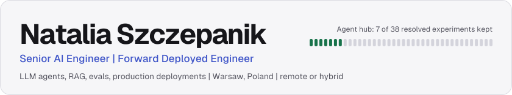
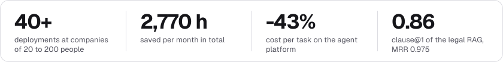
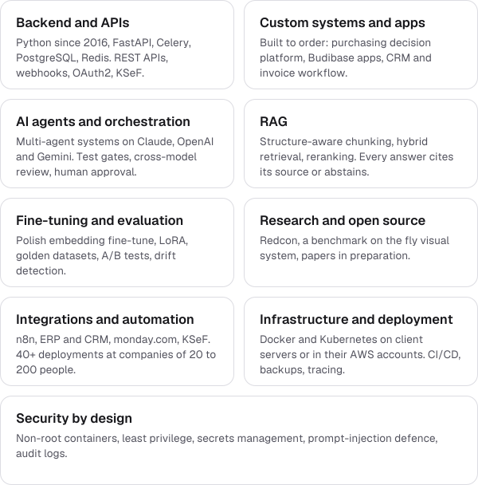
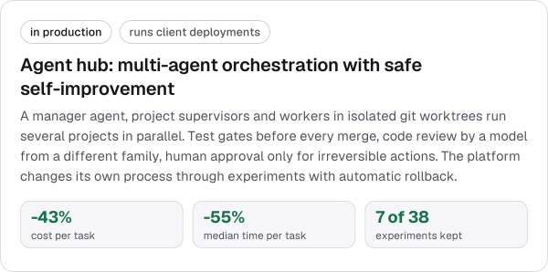
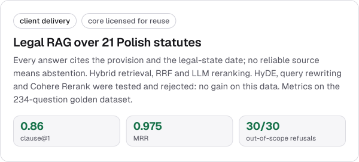
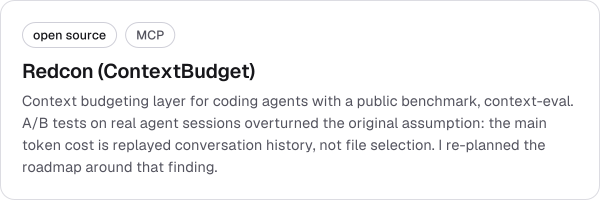
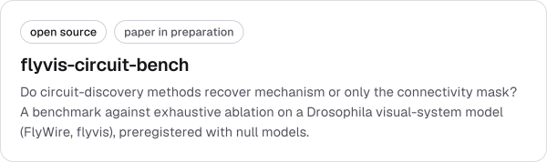
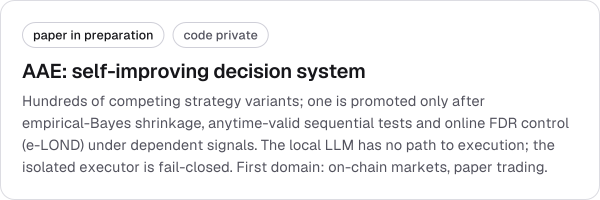
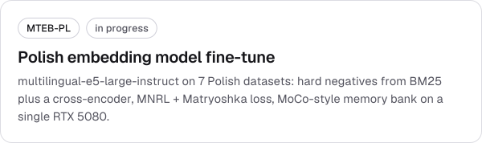
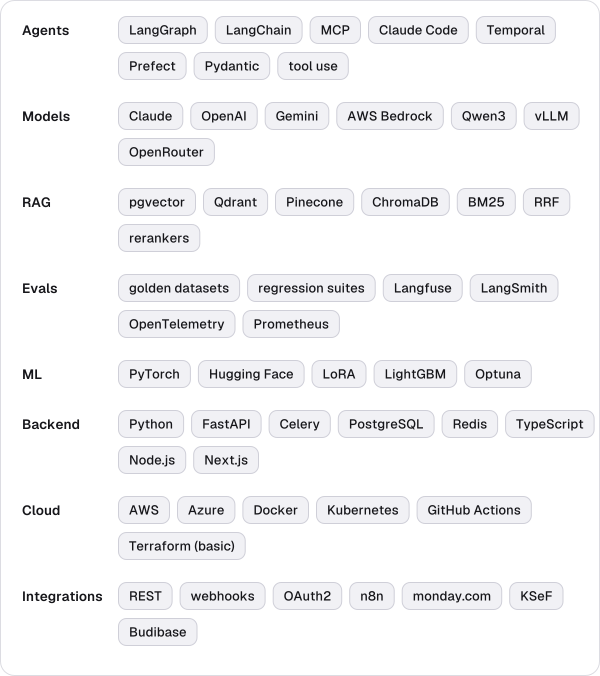

<picture>
  <source media="(prefers-color-scheme: dark)" srcset="assets/banner-dark.svg">
  
</picture>

[Portfolio](https://natiixnt.github.io/portfolio/) | [LinkedIn](https://www.linkedin.com/in/naithai/) | [natjiks@gmail.com](mailto:natjiks@gmail.com)

## Selected impact

<picture>
  <source media="(prefers-color-scheme: dark)" srcset="assets/impact-dark.svg">
  
</picture>

## What I do

<picture>
  <source media="(prefers-color-scheme: dark)" srcset="assets/scope-dark.svg">
  
</picture>

## Projects and research

<picture>
  <source media="(prefers-color-scheme: dark)" srcset="assets/card-agent-hub-dark.svg">
  
</picture>

<picture>
  <source media="(prefers-color-scheme: dark)" srcset="assets/card-legal-rag-dark.svg">
  
</picture>

<a href="https://github.com/natiixnt/redcon">
<picture>
  <source media="(prefers-color-scheme: dark)" srcset="assets/card-redcon-dark.svg">
  
</picture>
</a>

[natiixnt/redcon](https://github.com/natiixnt/redcon)

<a href="https://github.com/natiixnt/flyvis-circuit-bench">
<picture>
  <source media="(prefers-color-scheme: dark)" srcset="assets/card-flyvis-dark.svg">
  
</picture>
</a>

[natiixnt/flyvis-circuit-bench](https://github.com/natiixnt/flyvis-circuit-bench)

<picture>
  <source media="(prefers-color-scheme: dark)" srcset="assets/card-aae-dark.svg">
  
</picture>

<picture>
  <source media="(prefers-color-scheme: dark)" srcset="assets/card-embedding-dark.svg">
  
</picture>

## Stack

<picture>
  <source media="(prefers-color-scheme: dark)" srcset="assets/stack-dark.svg">
  
</picture>

## Contact

Open to a permanent Senior AI Engineer or Forward Deployed Engineer role. Warsaw, Poland, remote or hybrid.

[natjiks@gmail.com](mailto:natjiks@gmail.com) | [LinkedIn](https://www.linkedin.com/in/naithai/) | [Portfolio](https://natiixnt.github.io/portfolio/)
