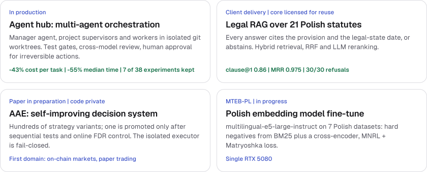

<picture>
  <source media="(max-width: 600px) and (prefers-color-scheme: dark)" srcset="assets/banner-m-dark.svg">
  <source media="(max-width: 600px)" srcset="assets/banner-m-light.svg">
  <source media="(prefers-color-scheme: dark)" srcset="assets/banner-dark.svg">
  
</picture>

Open to a permanent Senior AI Engineer or Forward Deployed Engineer role. [Portfolio](https://natiixnt.github.io/portfolio/) | [LinkedIn](https://www.linkedin.com/in/naithai/) | [natjiks@gmail.com](mailto:natjiks@gmail.com)

<picture>
  <source media="(max-width: 600px) and (prefers-color-scheme: dark)" srcset="assets/impact-m-dark.svg">
  <source media="(max-width: 600px)" srcset="assets/impact-m-light.svg">
  <source media="(prefers-color-scheme: dark)" srcset="assets/impact-dark.svg">
  
</picture>

<picture>
  <source media="(max-width: 600px) and (prefers-color-scheme: dark)" srcset="assets/projects-m-dark.svg">
  <source media="(max-width: 600px)" srcset="assets/projects-m-light.svg">
  <source media="(prefers-color-scheme: dark)" srcset="assets/projects-dark.svg">
  
</picture>

**More:** open source and research in the pinned repositories: [redcon](https://github.com/natiixnt/redcon), [flyvis-circuit-bench](https://github.com/natiixnt/flyvis-circuit-bench), n8n-autopilot, crm-autopilot, aws-autopilot, azure-autopilot.

**What I do:** backend and APIs, custom systems and apps, AI agents and orchestration, RAG, fine-tuning and evaluation, integrations and automation, infrastructure and deployment, security by design.

**Stack:** LangGraph, LangChain, MCP, Claude, OpenAI, Gemini, pgvector, Qdrant, PyTorch, Python, FastAPI, PostgreSQL, Docker, Kubernetes, AWS, Azure, GitHub Actions, n8n.
